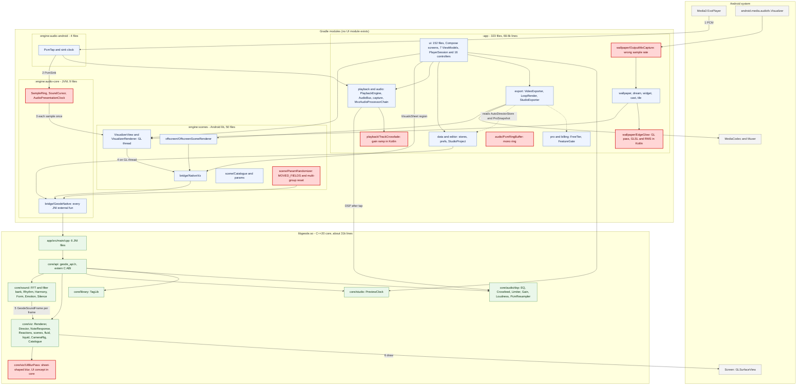
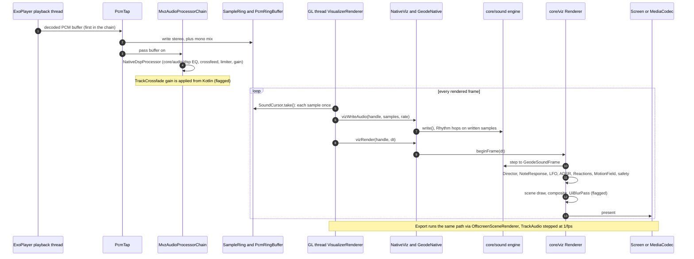
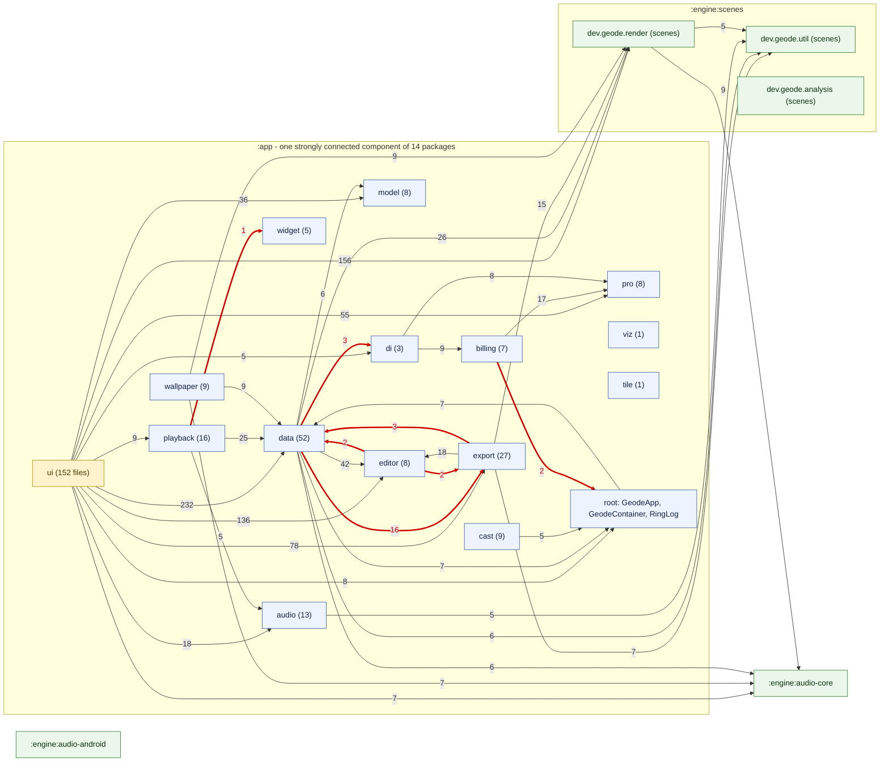
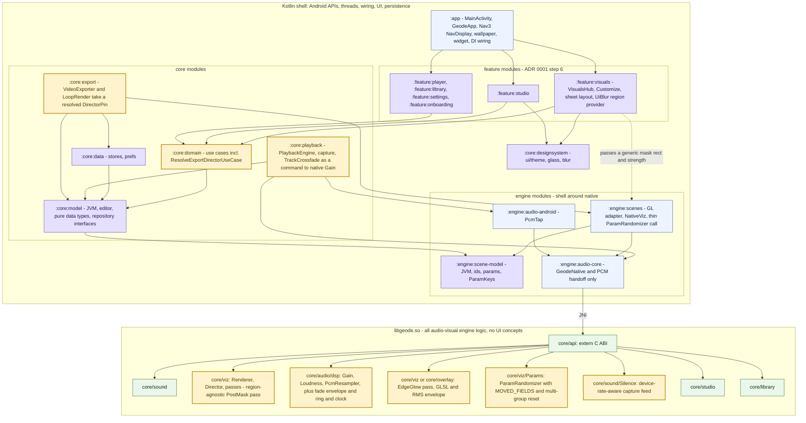

# Geode architecture analysis

Whole-system review of `tessie1993/geode-app` at `claude/geode-finish` (`5c40fcaa`). The Graphify index was built at `3313bd5`, a few merges earlier; every number below was also re-measured on the checkout. Method: the `architecture-review` steps (context, ADR audit, interaction mapping, invariant check, principle checks, risks and actions). The `engineering:architecture` skill is not installed in this environment, so only `architecture-review` was followed.

**How the evidence was gathered.** Graphify gave the hub structure: `PlayerSession` (183 symbols, 63 neighbouring files), `GeodeNative` (100 `external fun`, 14 neighbouring files), `NativeViz` (47 symbols, 9 neighbouring files) and `AppRoot` (36 neighbouring files). Graphify has no package-level aggregation and its `tests_for` matches by symbol name (it returned unrelated C++ tests for `PlayerSession`), so the package matrix comes from an exact scan of every Kotlin `import dev.geode.*` line, and test coverage comes from counting test files. Neither is a Graphify result; both are labelled where used.

## 1. Verdict: approve with actions

The shape is sound. The engine modules never import app code (0 edges from `:engine:*` into `:app`), nothing outside `ui/` and `di/` names `dev.geode.ui`, and the native core is a clean static library behind one C ABI. The debt is concentrated in three places:

1. `:app` is one tangled module: all 14 of its packages form a single strongly connected component, which blocks ADR 0001 steps 2 to 6.
2. A handful of engine behaviours still live in Kotlin (ADR 0003), and one UI concept lives in C++.
3. The areas that carry the most risk (playback, wallpaper, cast, editor, the native renderer) have no unit tests.

## 2. Is there a separate UI Gradle module?

**No.** `settings.gradle.kts` includes exactly `:app`, `:engine:audio-core`, `:engine:scenes` and `:engine:audio-android`, and there are four `build.gradle.kts` files outside `build-logic` and the root. The same `settings.gradle.kts` (identical blob SHA) is on `claude/geode-finish`, `claude/t1a-design-system` and `codex/add-opaline-ui-system`. I did not open the other ~270 branches, so an unmerged UI module on some other branch is possible but I found none. What exists is the *plan* for one: ADR 0001 lists `:core:designsystem` and `:feature:*` as steps 3 and 6, and `AGENTS.md` describes `ui/theme` as "ready to move into `:core:designsystem`". Today the UI is `dev.geode.ui` inside `:app`: 152 of 323 files, with 7 ViewModels.

## 3. System architecture

Runtime flow (numbers match the diagram): ExoPlayer decodes, `PcmTap` copies each buffer first in the chain into `SampleRing`, the GL thread reads each sample once through `SoundCursor` and writes it into the native renderer's own `core/sound` engine, which `beginFrame` steps once per frame into a `GeodeSoundFrame`. `Director`, `NoteResponse`, LFO, ADSR, `Reactions` and `MotionField` run in `core/viz`, then the frame goes to the screen, or through `OffscreenSceneRenderer` into MediaCodec for export (same maths, `TrackAudio` stepped at 1/fps). The wallpaper and dream build their own `VisualizerView` and read `AudioBus.soundInput`.

### One audio frame

## 4. Dependencies

Edges are import counts between top-level packages (exact scan, 40 shown: every edge of 5 or more, plus every edge against the intended direction). Red is against the ADR 0001 target direction.

### Findings

| # | Finding | Evidence | Why it matters |
|---|---|---|---|
| D1 | `:app` is one strongly connected component of 14 packages (`ui`, `data`, `editor`, `export`, `pro`, `model`, `playback`, `audio`, `wallpaper`, `cast`, `billing`, `di`, `widget`, `viz`, plus root files) | Tarjan over the package graph | No package can move to its own module until the cycles below are cut |
| D2 | `data` and `export` import each other: `data→export` 16, `export→data` 3 | `EditorProjectJson`, `ExportPrefs`, `StorageRepository`, `TemplateRepository`, `VideoTemplate` import `export.*` | `:core:data` and `:core:export` cannot both exist in ADR 0001's dependency rule |
| D3 | `editor` is declared pure but imports `export.ClipEdit` (`Timeline`, `AnimatableParams`) and `data.ExportDefaults` and `ExportDestination` (`StudioProject`) | `editor→export` 2, `editor→data` 2; `data→editor` is 42 | `:core:model` (step 2) must not depend on `data` or `export`; these three types belong in `model` |
| D4 | `data` imports `di` (`IoDispatcher`) in `SettingsReset`, `BackupRepository`, `StorageRepository` | 3 imports | A data class knows Hilt qualifiers; pass the dispatcher in |
| D5 | `playback` ↔ `widget` and `billing` ↔ root file | 1 and 2 imports | Small, but each is a cycle |
| D6 | `pro` ("pure Kotlin") imports `dev.geode.render.scene.*` from the Android library `:engine:scenes` | `FreeTier` | Fine today; blocks `pro` becoming a JVM module until `:engine:scene-model` exists (ADR 0001) |
| D7 | The layer gate holds: 0 files outside `ui/` and `di/` import `dev.geode.ui` | grep of `app/` and `engine/` | Good; keep `tools/layer-gate.sh` |
| D8 | Packages `dev.geode.audio`, `dev.geode.analysis` and `dev.geode.util` are split across `:app` and `:engine:scenes` (for example `AiffPcm.kt` is in `scenes`, `AudioBus.kt` in `app`) | package declarations | Split packages block clean module extraction and confuse the import graph |
| D9 | `GeodeNative` (100 `external fun`) sits in `:engine:audio-core`, which is described as "pure Kotlin, JVM", yet it carries `viz*`, `preview*`, `params*` and `macros*` entry points | Graphify symbol list | The module name no longer matches its content; the viz half belongs beside `NativeViz` |

### Coupling hotspots (Graphify)

| Hotspot | Number | Reading |
|---|---|---|
| `ui/PlayerSession.kt` | 183 symbols, 63 neighbouring files, referenced by 16 files; 16 controllers and ~10 repositories built by hand | The god object ADR 0001 step 4 dissolves. Most methods are one-line delegations (`fun toggleShuffle() = settings.toggleShuffle()`) |
| `di/PlayerSessionProvider` | 9 files; `GeodeContainer` is used by 10 files | A service locator running beside Hilt |
| `ui/AppShell.kt` (`AppRoot`) | 36 neighbouring files; also hosts `SearchScreen` and `SettingsScreen` composables | Shell plus two screens in one 898-line file |
| `GeodeNative` | 20 Kotlin files call it directly; `NativeViz` fronts the viz half for 7 `scenes` files and 3 `app` files | The JNI surface is wide but well funnelled. `data/MacroStore`, `AutoDirectorStore`, `NoteResponseStore` and `NativeTags` also push straight to native |
| `ui→data` | 232 imports; `ui→render` 156; `ui→editor` 136 | The UI layer reaches everything; fine for now, but it is why no feature module can be cut yet |

## 5. Violations of the owner's rules

Red in the diagrams. Each row is a finding, not a fix; the fixes are ranked in section 8.

### 5.1 Kotlin in the engine (ADR 0003)

| File | Lines | What is engine logic there | Native home that already exists or is needed |
|---|---|---|---|
| `app/.../wallpaper/EdgeGlow.kt` | 301 | A GLES30 pass with embedded GLSL, plus an RMS envelope | New pass in `core/viz`, RMS from `core/sound`; GLSL to `assets/shaders` |
| `app/.../playback/TrackCrossfade.kt` | 95 | A gain ramp (fade out, fade in) computed in Kotlin | `core/audio/dsp/Gain.hpp` exists; add the envelope there |
| `engine/scenes/.../scene/ParamRandomizer.kt` | 134 | `MOVED_FIELDS` and the multi-group reset composed in Kotlin on top of native `paramsRandomize` and `paramsResetTab` | `core/viz/ParamRandomizer` should own group composition |
| `app/.../wallpaper/OutputMixCapture.kt` | 123 | Reports the device sample rate (`FALLBACK_RATE_HZ`, `samplingRate`) although the `Visualizer` delivers about 20k samples a second, so rhythm hops and filters are tuned to the wrong rate | The native sound engine needs the true delivery rate; the Kotlin side should only forward it |
| `export/VideoExporter.kt:435`, `export/LoopRender.kt:540` | n/a | Call `AutoDirectorStore.get(context)` and `ProSnapshot.gate(context)` directly to build the director pin | A resolved pin passed in by the caller (`ExportController`) or a use case. It is a shell layering problem, not engine maths |
| `SampleRing`, `AudioPresentationClock`, `ClockSegment` (audio-core); `audio/PcmRingBuffer` (app) | 358 | Per-buffer ring and clock maths | ADR 0003's open row, blocked on how `core/sound` takes PCM |
| `analysis/ArtPalette` | 78 | Per-pixel hue histogram that tints the visuals | `core/viz`, ADR 0003's open row |

### 5.2 UI inside the native core

`core/viz/UiBlurPass.{hpp,cpp}` (198 lines), `assets/shaders/ui_blur_frag.glsl`, `ui_blur_mask_frag.glsl`, the `geode_viz_set_ui_blur_region` entry in `core/api/geode_api.h`, `NativeViz.setUiBlurRegion`, `GeodeNative.vizSetUiBlurRegion`, and the wiring in `Renderer.hpp`, `Renderer.cpp`, `RendererFrame.cpp`. The header says it plainly: "frosted glass for the Compose sheet that floats over the visual", with a region set from `VisualsSheet.kt`'s layout. A search of `core/` for other UI vocabulary (sheet, glass as a UI word, mini player, dock, toolbar, paywall, tab bar) found nothing else. Comments in `Catalogue.hpp` and `geode_viz_api.cpp` mention the app (Pro rule, "app's sheet blur") but carry no UI logic. This is the only UI-in-core case.

**There is a real constraint behind it.** The `UiBlurPass` header explains that the sheet is Compose over a separate `GLSurfaceView`, so a `RenderEffect` in the sheet's window cannot sample the visual's pixels. That is why the blur is in the renderer. I did not find a way to move it to the shell without losing the effect.

### Invariant Conflicts

[I1] **"No UI in the native core" against "the shell cannot sample the GL surface"**
- **Conflict**: the rule needs the blur out of `core/`; the platform stops the sheet from blurring the surface from outside.
- **Options**: *Preserve* the rule (delete `UiBlurPass`; the sheet gets only its tint, losing the frosted look). *Layer on top* (keep the pass but rename it to a generic region blur with no sheet, corner or glass vocabulary, so the core exposes a post-effect and the shell decides what it is for). *Revise* the rule (allow named post-effects whose parameters are screen regions).
- **Recommendation**: ESCALATE TO HUMAN. "Layer on top" is the cheapest, but it is a judgement about what counts as "UI", and it is the owner's call.
- **Risk if wrong**: a rename hides the problem and the next sheet-shaped feature repeats it; deletion removes a shipped visual feature (PR #282).

## 6. ADR compliance

| ADR | Status in file | State of the code |
|---|---|---|
| 0001 target module split | `proposed` | Step 1 done (reverse deps fixed, layer gate live). Steps 2 to 6 not started: no `:core:*` or `:feature:*` module exists. The ADR's header says "proposed" although step 1 shipped; it should be marked partially accepted |
| 0002 release before restructure | present | Superseded in part by 0005 for Studio, Visuals and Customize |
| 0003 engine internals in C++ | `accepted` | Done: `TouchField`, `CymaticsMath`, loudness, resampler, catalogue, randomizer. Open: ring and clock, `ArtPalette`. New violations since the ADR: `EdgeGlow`, `TrackCrossfade`, and the `ParamRandomizer` composition |
| 0005 wave 1 before release | `accepted` | Studio project model is in `editor/StudioProject.kt` as stated |
| 0004 | **missing** | The directory has 0001, 0002, 0003, 0005. Either a number was skipped or an ADR was never merged |

`ANDROID_ARCHITECTURE_GUIDE.md` says composables and ViewModels never touch data sources. `AGENTS.md` already lists the exceptions (`StudioScreen`, `MyVideosTab`, `TimelineLanes`, `TrackInfoEditor` and others call `contentResolver`).

New ADR needed: one for the `UiBlurPass` decision (I1) and one for the `GeodeNative` split (D9), since both are choices between structural options.

## 7. Test coverage by area

Counted as test files per source package (Kotlin) and per native area. Graphify `tests_for` was not used for this because it matches by name.

| Area | Source files | Unit tests | Gap |
|---|---|---|---|
| `ui` | 152 | 5 (+1 `ui/pro`, +1 `ui/theme`) plus 16 instrumented, including `ReactivityTabTest` | `PlayerSession` and the 16 controllers have no test |
| `data` | 52 | 6 (+1 backup) | Stores are mostly untested; `TemplateRepository` (726 lines) and `EditorProjectStore` have none |
| `export` | 27 | 6 | `VideoExporter`, `LoopRender` (922), `StudioExporter`: no unit test (the instrumented journeys cover the happy path) |
| `playback` | 16 | **0** | `PlaybackService`, `TrackCrossfade`, `QueueEnd`, sleep timer |
| `audio` | 13 | 1 (`audio/dsp`) | Capture, `AudioBus`, `PcmRingBuffer` |
| `wallpaper` | 9 | **0** | `EdgeGlow`, `OutputMixCapture`, `wallpaperRunMode` |
| `cast` | 9 | **0** | `CastStream`, `LiveSegments`, `LiveHttpServer` |
| `editor` | 8 | **0** (no test mentions `Timeline` or `Keyframes`) | Pure Kotlin with a large model (`Timeline.kt` 730 lines); the cheapest gap to close |
| `model`, `pro`, `billing`, `widget` | 8, 8, 7, 5 | 4, 3, 2, 1 | Reasonable |
| `:engine:scenes` | 50 | 11 | Wire layouts, catalogue, codec covered |
| `:engine:audio-core` | 9 | 3 | |
| `:engine:audio-android` | 4 | **0** | `PcmTap` and the sink clock are the audio path's first stage |
| native `core/` | about 31k lines | 11 host tests (`sound`, `musical`, `director`, `note_response`, `liquid`, `fluid_math`, `viz_math`, `params`, `catalogue`, `loudness`, `resampler`) | `Renderer`, `RendererFrame`, `UiBlurPass`, `CompositePass`, `StyleSchedule`, `PreviewClock`, `library/` (TagLib wrapper) have no host test; GL passes are checked only by `tools/glslcheck` and the emulator |

## 8. Recommended changes, ranked

Rank weighs the owner's two rules first, then what unblocks ADR 0001, then cost. Risk is the chance of a user-visible regression.

| Rank | Change | Target home | Risk | ADR |
|---|---|---|---|---|
| 1 | Decide I1 (`UiBlurPass`), then rename or remove it and its API | Owner decision; if kept, a generic region-blur effect in `core/viz` with no sheet vocabulary | Medium: touches the live render path and the Visuals sheet | new ADR, 0003 |
| 2 | Move `EdgeGlow` to native (pass, GLSL, RMS envelope) | `core/viz` pass plus `core/sound` level; `assets/shaders`; Kotlin keeps only the wallpaper hook | Medium: GL state on the wallpaper surface, and no test exists today | 0003 |
| 3 | Fix `OutputMixCapture` to forward the true delivery rate and let native own the rate handling | `core/sound`; Kotlin forwards the rate | Low to medium: it changes how wallpaper audio reacts, so check on a device | 0003 |
| 4 | Move `TrackCrossfade`'s ramp into the native gain stage | `core/audio/dsp/Gain.hpp` (envelope), driven through `NativeDspProcessor`; keep the tap first and no float output (`AUDIO_CHAIN.md`) | Medium: audio-thread timing and the UI-fade multiply in `PlaybackSession.setUiVolume` | 0003 |
| 5 | Finish `ParamRandomizer`: move `MOVED_FIELDS` and group composition into `core/viz/ParamRandomizer`; make the Kotlin object a pass-through | `core/viz`, with a case in `params_test.cpp` | Low: the native test already covers randomisation | 0003 |
| 6 | Stop exporters reading `AutoDirectorStore` and `ProSnapshot`: build the pin in `ExportController` and pass it in `ExportJob` | `export` receives a value; the lookup becomes a use case | Low | 0001 step 4, guide |
| 7 | Break the cycles D2 to D5: move `ClipEdit`, `ExportDefaults`, `ExportDestination` to `model`; take `IoDispatcher` as a parameter in `data` | `dev.geode.model`, then `:core:model` | Low to medium: wide import changes, but mechanical | 0001 steps 1 and 2 |
| 8 | Add the missing unit tests: `editor` (pure, cheap), `playback`, `wallpaper` run-mode, `cast` segmenter, `audio-android` clock; host tests for `StyleSchedule` and `PreviewClock` | each area's test folder; `core/tests` | Low | guide |
| 9 | Split `GeodeNative` by area (or rename the module) and stop the split packages `dev.geode.audio/analysis/util` | `:engine:audio-core` keeps audio and preview; viz and params move next to `NativeViz` | Low: JNI names do not change if the Kotlin object names are kept | 0001, new ADR |
| 10 | Port the ring and clock (`SampleRing`, `AudioPresentationClock`, `ClockSegment`, `PcmRingBuffer`) and `ArtPalette` | `core/audio`, `core/viz` | High: it changes how every renderer is fed; waits on sound-wiring | 0003 (open rows) |
| 11 | Dissolve `PlayerSession` and `GeodeContainer` into repositories and use cases | `:core:*` modules | High: shared lifecycle with all 7 ViewModels | 0001 step 4 |
| 12 | Extract `:core:designsystem`, then `:feature:*` | New modules | Medium | 0001 steps 3 and 6 |

Ranks 6, 7, 8 and 9 are low-risk and can start now. Ranks 10 to 12 stay after the release as ADR 0002 and 0005 say.

## 9. Target architecture

Yellow nodes are where the flagged pieces end up; purple nodes are modules that ADR 0001 plans but do not exist yet.

Where each flagged piece moves: `EdgeGlow` → native overlay pass; `TrackCrossfade` → `core/audio/dsp` envelope; `ParamRandomizer` composition → `core/viz/Params`; `OutputMixCapture` rate → native feed; exporters' store reads → `:core:domain` use case feeding `:core:export`; `UiBlurPass` → a region-agnostic post-effect, pending I1. Ring and clock maths follow when the sound-wiring work lands.

## 10. Limits of this review

- One session audits PRs #182 to #292 separately; this document does not audit individual PRs.
- The five known violations were taken as given and spot-checked, not re-investigated, except that I confirmed the `AutoDirectorStore` and `ProSnapshot` calls in `VideoExporter` and `LoopRender` and the existence of `Gain.hpp`.
- I did not build or run anything (the repo forbids local builds). Line counts are from the checkout.
- The package matrix counts imports, not calls; a heavily used type counts once per file.
- The Graphify index lags the checkout by a few merges.
