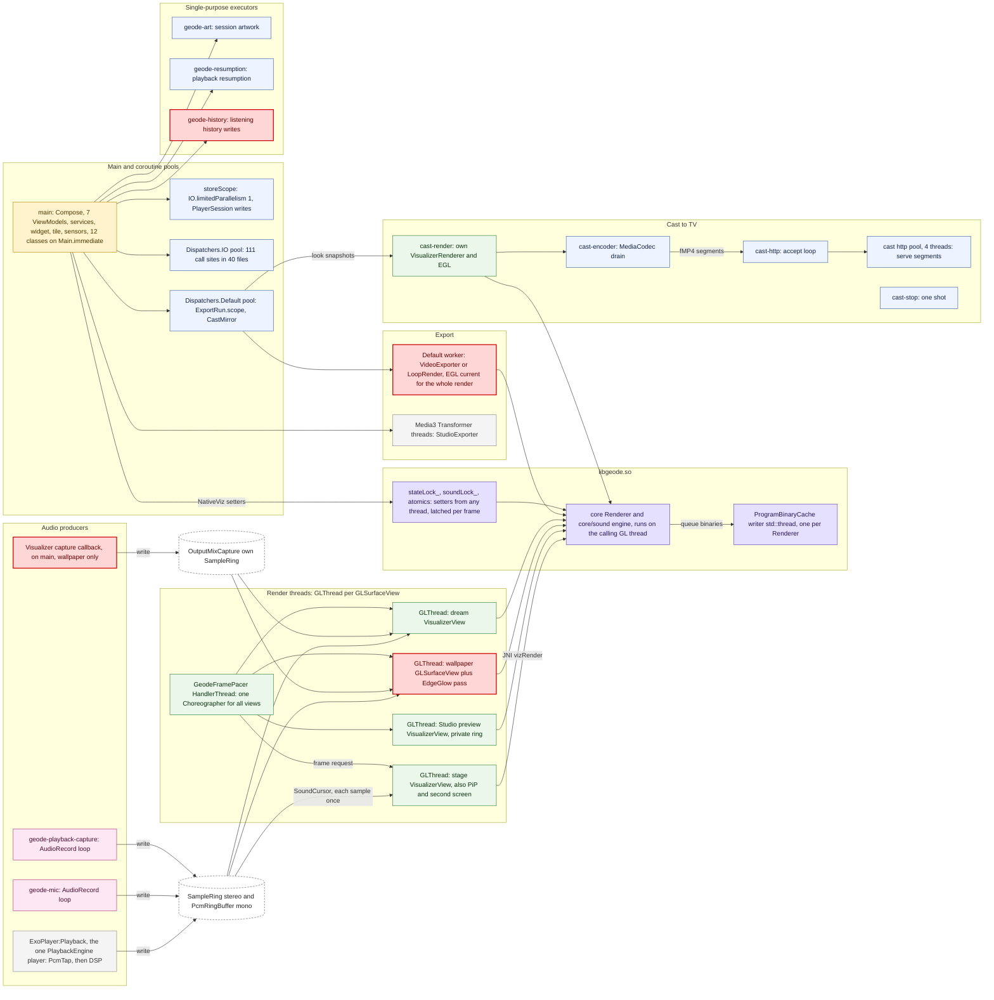

# Geode threads

Every thread the app creates or runs its own code on, at `claude/geode-finish` (`5c40fcaa`). Found by searching all of `app/src/main`, `engine/*/src/main`, `core/` and `app/src/main/cpp` for `Thread(`, `thread(`, `HandlerThread`, `Executors.*`, `Dispatchers.*`, `CoroutineScope(`, `GLSurfaceView`, `EGL14`, `std::thread`, `pthread_*`, `std::async` and `thread_local`, then reading each hit. The submodules `third_party/projectm` and `third_party/taglib` create no threads.

**Short version:** the app creates **10 named threads plus one 4-thread pool** in Kotlin, and **one** kind of native thread (`ProgramBinaryCache`'s writer, one per renderer). Everything else runs on threads the platform makes: the main thread, one `GLThread` per `GLSurfaceView`, ExoPlayer's playback thread, and the two coroutine pools (`Default`, `IO`).

## Map

Red marks a thread worth a second look (see [Findings](#findings)).

## 1. Threads the app creates

| Thread name | Kind | Created in | Lives | Does |
|---|---|---|---|---|
| `GeodeFramePacer` | `HandlerThread`, `THREAD_PRIORITY_DISPLAY` | `engine/scenes/.../render/FramePacer.kt:347` (`object PacerThread`) | Whole process, shared by every `VisualizerView` | Owns a `Choreographer` off the main thread; each vsync it asks the views' GL threads for a frame (`requestRender`) |
| `geode-mic` | `kotlin.concurrent.thread`, daemon | `audio/AudioCapturePump.kt:65`, name from `audio/MicCapture.kt:33` | While the mic is on | `AudioRecord` read loop, writes the `PcmSink` (the rings) |
| `geode-playback-capture` | same | `AudioCapturePump.kt:65`, name from `audio/PlaybackCapture.kt:35` | While another app's audio is captured (MediaProjection) | Same loop on a playback-capture `AudioRecord` |
| `geode-art` | single-thread executor | `playback/SessionBitmapLoader.kt:22` | Process | Decodes media-session artwork for the notification, Android Auto and the lock screen |
| `geode-resumption` | single-thread executor, daemon | `playback/PlaybackService.kt:351` | Process | Builds the playback-resumption item for Media3 |
| `geode-history` | single-thread executor, daemon | `data/HistoryStore.kt:167` | Process | Writes listening history to disk |
| `cast-render` | `Thread` | `cast/CastStream.kt:80` | While casting | Its own `VisualizerRenderer` and EGL context, draws into the encoder surface |
| `cast-encoder` | `Thread` | `cast/CastEncoder.kt:78` | While casting | Drains the H.264/AAC `MediaCodec` into fragmented MP4 |
| `cast-http` | `Thread` | `cast/LiveHttpServer.kt:50` | While casting | Accept loop of the LAN HLS server |
| (pool, 4 threads) | `Executors.newFixedThreadPool(4)` | `cast/LiveHttpServer.kt:36` | While casting | Serves playlist and segment requests |
| `cast-stop` | `Thread`, one shot | `cast/CastService.kt:178` | Seconds | Stops the stream off the main thread |
| ProgramBinaryCache writer (unnamed) | `std::thread` | `core/viz/ProgramBinaryCache.cpp:69`, member of `core/viz/Renderer` (`Renderer.hpp:184`) | As long as its `Renderer` | Writes compiled shader binaries to the cache folder without stalling the GL thread. **One per native renderer**, so one each for the stage, Studio preview, wallpaper, dream, cast and every export |

## 2. Platform threads the app's code runs on

| Thread | Instances | Where it comes from | App code on it |
|---|---|---|---|
| **main** | 1 | Android | Compose UI, the 7 ViewModels (`viewModelScope`, 24 uses), every `LaunchedEffect` (110) and `rememberCoroutineScope` (19), all services' callbacks, the widget, the tile, sensor listeners (`GyroLook`, `DreamCover`), `Handler(Looper.getMainLooper())` in 9 classes, and 12 classes that use `Main.immediate` (scopes or `withContext`): `GeodeContainer.appScope`, `PlayerSession.scope`, `PlaybackEngine`, `PlaybackService`, `ExportService`, `PlayBillingRepository`, `WidgetPublisher.mainScope`, `PlayerSessionProvider`, `CaptureController`, `QueueController`, `BackgroundController`, `TemplateController`. Also the `Visualizer` capture callback of `wallpaper/OutputMixCapture` |
| **GLThread** (GLSurfaceView) | one per surface: stage `VisualizerView` (`ui/AppShell.kt:133`; the same view moves into PiP and the second-screen `Presentation`), Studio preview `VisualizerView` (`ui/StudioPreview.kt:199`), wallpaper `GLSurfaceView` (`wallpaper/VisualizerWallpaperService.kt:108`), dream `VisualizerView` (`wallpaper/VisualizerDreamService.kt:98`) | `GLSurfaceView` | `VisualizerRenderer.onDrawFrame` → `NativeViz` → JNI → `core/viz` Renderer and its own `core/sound` engine (each GL thread hears the ring through its own `SoundCursor`); the wallpaper's `WallpaperRenderer` and `EdgeGlow` pass; `queueEvent` hand-offs (6 sites) |
| **ExoPlayer:Playback** | one per `ExoPlayer`: `playback/PlaybackEngine.kt:84` (the music player), `ui/StudioPreviewController.kt:89` and `:93` (song lane, footage), `ui/StudioPreview.kt:87`, `ui/BootIntro.kt:113` (intro video) | Media3 | `MvzAudioProcessorChain`: `PcmTap` first (writes the rings), then `NativeDspProcessor` (`core/audio/dsp`). `TrackCrossfade` posts its gain from a main-thread coroutine |
| **Dispatchers.Default** | CPU-count pool | kotlinx.coroutines | `ExportRun.scope` (`export/ExportRun.kt:12`) running `VideoExporter`, `LoopRender`, `LoopExtend`; `CastMirror` (`cast/CastMirror.kt:32`); one call in `TemplateRepository` |
| **Dispatchers.IO** | shared pool | kotlinx.coroutines | 111 call sites in 40 files: stores, MediaStore, imports, thumbnails, artwork, ReplayGain, loudness decode. Plus `PlayerSession.storeScope` (`IO.limitedParallelism(1)`, `ui/PlayerSession.kt:101`), `QueueController.resolveScope`, `WidgetPublisher.scope` |
| Media3 Transformer and MediaCodec internals | per render | Media3, MediaCodec | `export/StudioExporter.kt:136` (`runTransformer`) |
| GL driver compile threads | driver-defined | `GL_KHR_parallel_shader_compile` | None of ours; `core/viz/ProgramStager` polls them so a new scene builds across frames |
| Binder threads | system | Android | Media3 session and controller IPC (`PlaybackService`, the tile's `MediaController`) |

## 3. What crosses between threads, and how it is guarded

| Hand-off | From → to | Guard |
|---|---|---|
| PCM | ExoPlayer:Playback, `geode-mic` or `geode-playback-capture` → every GL thread | `SampleRing` (one writer at a time, each reader its own `SoundCursor`), `PcmRingBuffer`; `CaptureController` decides which source owns the ring |
| Wallpaper sound with the app closed | main (`Visualizer` callback) → wallpaper or dream GL thread | `OutputMixCapture`'s own `SampleRing`; `SoundSource` switches between it and the app's ring |
| Look, params, routes, touch, UI blur region | main → GL thread | Native setters callable from any thread: `Renderer::stateLock_`, `soundLock_` and ~20 atomics (`Renderer.hpp:191–320`), `TouchField::lock_`, `Overlays::strokeLock_`, `FluidSim::injectionLock_`, `MilkdropScene::presetLock_`; latched at the next `beginFrame` |
| Process-wide engine settings | main → every renderer | Atomics in `core/viz/Macros.cpp`, `Director.cpp`, `Reactions.cpp` (`HandMask`), `NoteResponse.cpp` |
| EQ, gain, limiter | main → ExoPlayer:Playback | Atomics in `core/audio/dsp/Equalizer.hpp`, `Gain.hpp`, `Limiter.hpp`, `Crossfeed.hpp` |
| Frame ticks | `GeodeFramePacer` → GL threads | `requestRender()` (GLSurfaceView's own queue) |
| Director moments | GL thread → main | `geode_viz_take_director_style_moments` (atomic counter), then `AutoVisualsController` on main |
| Cast look | Default (`CastMirror`) → `cast-render` | Read on the render thread only (`CastStream.mirrored`) |
| Shader binaries | GL thread → native writer | `ProgramBinaryCache` mutex, queue and condition variable |
| Kotlin side | various | 134 sites of `@Volatile`, `synchronized`, `Atomic*` and locks in 40 files; most in `VisualizerRenderer` (20), `HistoryStore` (9), `FramePacer` (6). 31 functions are marked `@WorkerThread`, mostly in `EditorProjectStore`, `TakeStore`, `PresetStore`, `TemplateRepository` |

## Findings

1. **An export pins one `Default` worker for the whole render.** `VideoExporter.encodeInto` and `LoopRender.renderStop` make an EGL context current and render every frame in non-suspending code, so the context never changes thread (correct). But it blocks a CPU-pool thread for minutes. `CastMirror` and every other `Default` user share that pool; on a 4-core device a batch render takes a quarter of it. A dedicated render thread (like `cast-render`) would keep `Default` free and make the EGL ownership explicit.
2. **One native writer thread per renderer.** Each `core/viz/Renderer` owns a `ProgramBinaryCache` with its own `std::thread`. With the stage, Studio preview, wallpaper and an export alive at once that is four writers for one cache folder. A single process-wide writer would do the same job.
3. **Two serial disk writers for user data.** `PlayerSession.storeScope` (`IO.limitedParallelism(1)`) and `HistoryStore`'s own `geode-history` executor both exist to serialise writes. `HistoryStore` could use the same mechanism; today there are two orderings to reason about.
4. **The wallpaper's sound arrives on the main thread.** `OutputMixCapture`'s `Visualizer` callback runs on the main looper, where the launcher also draws. This is in addition to its sample-rate problem (see `ARCHITECTURE_ANALYSIS.md` §5.1).
5. **Thread ownership is mostly documented in KDoc, not in types.** Only 35 annotations (`@WorkerThread` 31, `@MainThread` 2, `@AnyThread` 2) exist, and none for the GL thread. Comments such as "GL thread only" and "render thread only" carry the rule. A `@GlThread` annotation, or moving those classes behind `NativeViz`, would let lint check it.
6. **Native code is single-threaded by design.** Apart from the writer, nothing in `core/` starts a thread: each renderer and its sound engine run on whichever GL or export thread calls them, and every cross-thread input goes through a latched setter. That matches ADR 0003 and is the reason export equals live.
