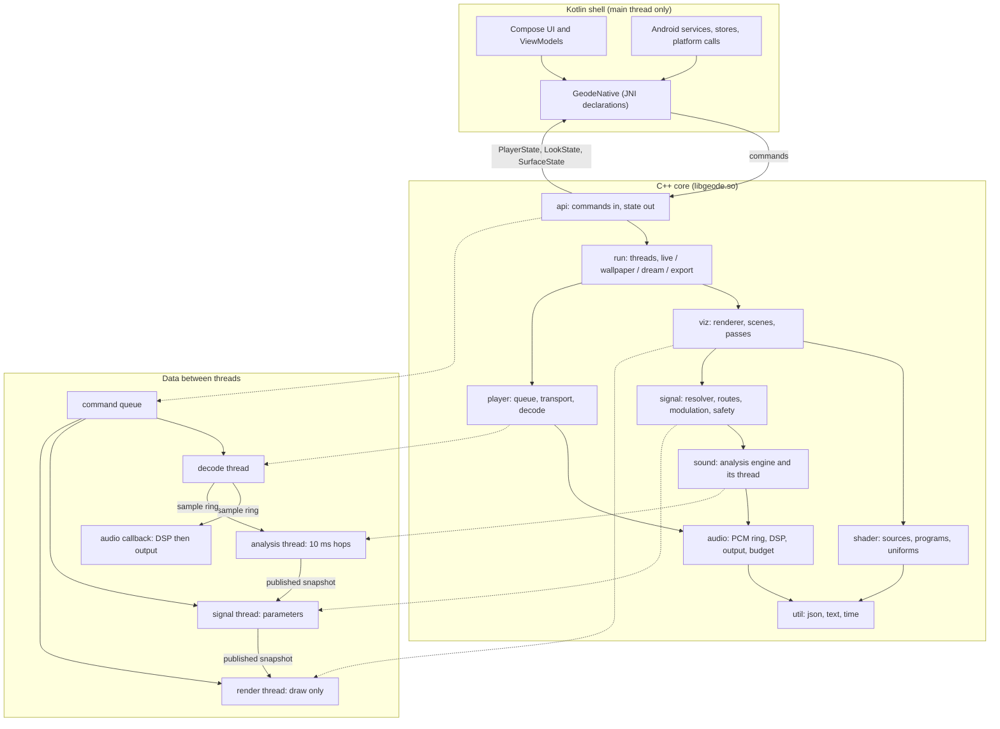

# Native engine: architecture and end-to-end plan

Status: proposed, awaiting the owner's approval. No code has been changed.
Basis: six read-only scans of the source at `10f984d` (first pass, Kotlin shell, sound analysis, render path, threads and audio I/O, shaders).
Every cost here is an estimate from reading code; nothing was measured on a device.
This extends `2026-11-17-pipeline-refactor-design.md`. Where the two disagree, this one is newer.

## 1. What the owner decided (2026-11-18)

- ExoPlayer no longer has to be the player. No PCM class in Kotlin, `PcmTap` included.
- No logic in Kotlin, ever.
- No hard-coded buffer sizes.
- Every rule in Kotlin moves to C++, the non-visual ones too: the music library, playlists, play history, the saved session, backup, the onboarding tour, shelves and filters. Kotlin performs platform IO only.
- More modular code, more efficient threads, best performance.

## 2. Assumptions to confirm

These are the recommended answers to the questions the owner did not answer one by one. Strike any that are wrong.

- A1. Media3 stays only as the media session shell (lock screen, notification, Android Auto, Bluetooth buttons). Native owns decode, DSP, output, clock and gapless.
- A2. The native player ships with parity except speed and pitch, which follow in a second step. The clean-room rule means the time-stretcher is written here from scratch.
- A3. One output: Oboe. The AudioTrack path is deleted.
- A4. "No hard-coded buffer" means every size is computed at run time from the device's burst size and sample rate. Durations in seconds stay as named constants.
- A5. Native owns the queue, fades, sleep timer, Auto scheduling, the look, undo and export sequencing. Kotlin keeps screens, Android services, platform calls and JNI declarations.
- A6. `CLAUDE.md` is changed first, so no later agent restores the tap.
- A7. Staged pull requests, each green in CI. The native player sits behind a Settings switch for one release, then the ExoPlayer audio path is deleted.
- A8. CI-built APKs are measured on the owner's phone before and after each phase.

## 3. What the scans found

### 3.1 Already right

- Live analysis has its own thread per ring (`core/sound/hop/AnalysisThread.cpp`). The renderer only reads published hops.
- The audio sample path is lock-free: ring write, output fifo and the Oboe callback use atomics only.
- No heap allocation on the per-sample or per-hop analysis path.
- No tempo number in Kotlin or in any shader. `GeodeNative.kt` holds declarations only.
- Ray-march step counts are scaled by the Detail dial in every marching style.

### 3.2 Threads

- The pacer computes each frame's step from the vsync time, then discards it; the renderer re-reads the wall clock (`core/stage/android/VsyncThread.cpp:151-158`, `core/api/geode_viz_api.cpp:584`).
- The pacer thread has a higher priority than the drawing thread it wakes (`VsyncThread.cpp:21`, `StageThread.cpp:20`).
- Live frames are given no presentation time.
- A 60 fps cap on a 90 Hz panel draws 45 fps (`core/viz/frame/Pacer.hpp:107-117`).
- One lock is held across the whole frame draw and is also taken by the main thread (`core/stage/LiveClient.cpp:22-25`).
- The main thread waits up to 1 s on a window change and 200 ms on quit (`StageThread.cpp:69`, `115-134`).
- The parameter chain runs on the drawing thread, once per surface (`core/viz/RendererFrame.cpp:247`).
- `stateLock_` is taken at least six times a frame in `RendererFrame.cpp`.
- Recording runs on the drawing thread, with a lock shared with the encoder and a heap allocation per audio block (`core/output/Recorder.cpp:196-208`).
- Record and cast encoder threads sleep 5 ms when idle; export waits in 10 ms steps.
- Output control calls (play, pause, flush, device) take a mutex a stream reopen can hold for 200 ms (`core/audio/output/OboeOutput.cpp:112-127`).
- The cast render loop and its EGL context are owned by a Kotlin thread (`cast/CastStream.kt:230-256`).

### 3.3 Duplicate or wasted work

- The analysis thread calls `step()` every pass and discards the result (`AnalysisThread.cpp:140-145`).
- `ReactSignals::step` (about 170 rows) runs in the resolver and again in every scene (`core/viz/SoundUniforms.cpp:34`).
- `MotionField` is stepped twice with the same seed (`core/signal/Resolver.cpp:150`, `core/viz/scenes/ShaderScene.cpp:90`).
- About 100 string-keyed uniform lookups per shader scene draw (`core/viz/Program.cpp:10`, `ShaderScene.cpp:445`).
- Up to about 30 whole `SceneParams` copies a frame (`core/viz/Lfo.cpp:173-180`, `Resolver.cpp:138-152`).
- The sound texture is uploaded for every shader scene draw, read or not (`SoundUniforms.cpp:40-58`).
- `glGetIntegerv`, `glGetError` and `glReadPixels` on the frame path in the MilkDrop, Life, Acid and fluid scenes.
- The palette ramp is reallocated with `glTexImage2D` on every change (`RendererFrame.cpp:304`).
- Each published hop is about 1.6 KB; a third of it is a waveform slot that is always zero.

### 3.4 Analysis cost

- The largest steady cost is per-sample filtering: about 24 biquads plus transient and loudness filters (`core/sound/SoundEngine.cpp:238-259`).
- Two complex FFTs per hop (2048 and 4096 points) on real input (`core/sound/Fft.cpp:24-26`).
- A one-second median is recomputed from scratch each hop (`core/sound/Transient.hpp:143-152`).
- Key correlation runs every hop on a four-second chroma (`core/sound/Harmony.cpp:268-273`).
- Tempo estimation is a burst of about 150k multiply-adds every 25 hops (`core/sound/Rhythm.cpp:149-156`).
- Drum and transient strength use the previous hop's drive value (`SoundEngine.cpp:708` against `1037`).

### 3.5 Hard-coded reactions

- 171 of 321 styles and 23 shared shader libs read sound directly with fixed constants. `lib_neon.glsl:102-112` fixes reactions for 99 styles.
- `ShaderScene.cpp:255-284` uploads motion-field sound values to every style.
- `NoteResponse.cpp:162-200` builds six style knobs from fixed weights.
- `CameraRig.cpp:192-206`: surge, kick, snare and bass move the camera.
- `MotionField.cpp:174-222`: about fifteen fixed sound-to-parameter terms.
- `FluidMath.cpp:104-108`, `FluidEmitters.cpp:36-84`, `FluidChoreography.cpp:36-65`.
- `LifeScene.cpp:151-199`, `AcidScene.cpp:108-213`, `SilkScene.cpp:120-216`.
- `RendererFrame.cpp:675-688`, `852-853`.

### 3.6 Colour narrowing

- A saturation boost of 1.2 to 1.25 plus a tone curve is pasted into eleven shader libs (`lib_neon.glsl:94-96` and ten others).
- `neonPal` pulls the palette toward the style's own colour (`lib_neon.glsl:79`).
- Fluid splats use fixed saturation and ignore the palette (`FluidEmitters.cpp:91,108,175,188`).
- The Director's Energy axis is held to a narrower range than safety allows (`Director.cpp:65-66`).

### 3.7 Tempo-shaped constants

- `Director.cpp:424`: with no tempo known the bar is 2 s, and a heard tempo is held to 1 to 4 s per bar. The comment calls 2 s a plain time, but it equals a bar at one particular tempo.
- `SoundEngine.cpp:37-38`: "busy" thresholds of 8 onsets and 4 hits per second make faster music read as busier.

### 3.8 Kotlin

- Kotlin owns the look, the wave and envelope configs, the macro bank and the palette stack, and pushes copies to native.
- JNI calls run un-remembered in slider and route rows on every recomposition (`ui/CustomizeTabs.kt:528`, `ui/CustomizeAdvanced.kt:185`).
- Seven polling tickers and one per-vsync main-thread poll (`stage/Stage.kt:350-370`).
- Loop extend, the AAC transcode shell and the batch export loop are Kotlin.
- JNI files hold logic, and one allocating, locking fallback sits on the audio thread (`app/src/main/cpp/geode_ingest_jni.cpp:46-77`).

### 3.9 Structure

- One static library; nothing enforces include direction.
- `core/viz` holds 295 files; about 200 make no graphics call.
- Include cycles: `signal` and `viz`, `audio` and `sound`, `audio` and `output`, `viz` and `output`.
- Engine code includes the C interface header 23 times.
- The C interface is one 2,246-line header mirrored by 598 Kotlin declarations written by hand.

## 4. Target architecture

### 4.1 Modules

Each module is its own CMake static library with a small public header folder. A module may link only modules above it in this list, so the build itself refuses a wrong include.

| Module | Owns | Interface in one line |
|---|---|---|
| `util` | time, atomics, snapshot and queue primitives | header-only helpers |
| `audio` | ring, DSP, codecs (decode, AAC), devices (output, mic, capture) | PCM in, PCM out, a device clock |
| `player` (new) | queue, transport, decode thread, gapless, fades, sleep | commands in, `PlayerState` out |
| `sound` | analysis and its thread | a ring in, a stream of hops out |
| `signal` | parameters, slot board, modulators, routes, director, the look document | a look and hops in, a stream of parameters out |
| `shader` | catalogue and source assembly, no graphics call | a style id in, source text and declared inputs out |
| `viz` | renderer, passes, scenes, compiled programs | parameters and hops in, a drawn frame out |
| `run` | the one frame driver for stage, wallpaper, record, export and cast | a clock, a target and a sound source in; frames presented |
| `api` | the C interface, one header per module | generated; included by JNI only |

- `viz` keeps only files that draw. Parameters, modulation, the director, palettes and touch gestures move to `signal`.
- Host tests link the module they test, so the 148 hand-written compile lines become one target per module.
- Section 4.7 gives each module's interface and the seams inside it.

### 4.2 Threads

| Thread | Count | Woken by | Does |
|---|---|---|---|
| Audio callback | 1 | the device | pulls the fifo, runs DSP and gain, counts frames played |
| Decode | 1 | fifo space freed | decodes, time-stretches, writes the ring and the fifo |
| Analysis | 1 per ring | samples written | hops, publishes |
| Signal | 1 per process | a new hop, an edit, a frame request | resolves every surface's parameters, publishes |
| Render | 1 per surface | its own vsync callback | draws from the latest published state |
| Encoder | 1 per recording, cast or export | a frame or audio block arriving | encodes and muxes |
| Main | 1 | the platform | sends commands, draws state |

- The vsync callback moves onto the render thread. The separate pacer thread, its hop and the priority inversion go.
- The frame step comes from vsync timestamps, and each frame is given its expected presentation time.
- Three ways for threads to talk, and no others:
  - a single-writer ring for samples,
  - a published snapshot for "the latest state",
  - a single-writer command queue for edits.
- No mutex on any per-sample, per-hop or per-frame path.
- Nothing waits on a timer. Encoder and export threads block on their queue.
- The main thread never waits on another thread; a window change is a command with an event in reply.
- Export runs decode, analysis, signal and render inline on one thread, so it matches live.

### 4.3 Native player

- Decode reuses `core/audio/ingest/android/TrackDecoder` and `AiffReader`, which the export path already uses.
- The tap is the decode thread's write to the ring: first, before any DSP, with no JVM class involved.
- DSP and gain run in the audio callback, so an EQ change or a fade is heard at once and the fifo can be deep.
- The playout clock is the callback's frame count plus the device's reported latency. `PlayoutSink` goes.
- Gapless: the next track's decoder is opened before the current one ends, and both write the same fifo.
- Kotlin keeps a thin media-session player that forwards commands and reports `PlayerState`.
- Deleted when the switch is removed: `PcmTap`, `NativeDspProcessor`, `MvzAudioProcessorChain`, `TapRenderersFactory`, `PlayoutSink`, `OboeAudioOutput`, `AiffExtractor`, `BitPerfectOutput`, and the `media3-exoplayer` dependency.

### 4.4 Buffers

- One file, `audio/Budget.hpp`, holds every duration as a named constant in seconds.
- Every size is computed from a duration, the stream's sample rate and the device's burst size when the stream opens.
- No literal frame or byte count anywhere else. Today's literals to remove: the 250 ms fifo, the 1024-frame capture read, the 64 KB scratch buffer in `LoopExtend`, the 128 and 256 hop histories.

### 4.5 Signal

- As the 2026-11-17 design: one board of slots, every modulator a module, routes compiled on change.
- The signal thread publishes each parameter with its rate of change; the renderer places it at the presentation time.
- Every hard-coded reaction in 3.5 becomes a declared input with a default route the user can see and edit.
- Parameters are edited in place on the board; the whole-struct copies go.

### 4.6 Kotlin

- Native holds the look, the queue and the surface state as documents.
- Kotlin sends commands and reads one published state block per domain: `PlayerState`, `LookState`, `SurfaceState`.
- Every ticker in 3.8 is deleted; a state block change wakes the screen.
- Labels and ranges the screens need are read once into the state block, not fetched per recomposition.
- The Kotlin declarations and constants are generated from the C interface headers.

### 4.7 Interfaces and seams

Words as in the codebase-design skill: a module has one interface; a seam is where an interface lives; an adapter fills a seam; a seam with one adapter is hypothetical and is not built.

**Where the interface is too wide today**

- The C interface has 654 functions, mirrored by 598 Kotlin declarations: 49 for the stage, 32 for the DSP, 31 for the loop job, 24 for macros, 22 for palettes.
- `Renderer` has 74 public member functions.
- Every consumer sees all of `GeodeSoundFrame`; 171 styles read its fields by name.
- The renderer reads process-wide state it was never handed: `sound::player::*`, `macrobank::publishLive`, `layer_state::publishShown`, `SceneResidency::trimSignal`, `transition_choice::takeAuto`.
- Five frame drivers each call the renderer in their own order: the live stage, video export, loop render, the record tee, and the cast loop in Kotlin.

**The interface each module gets**

| Module | Interface | Hidden behind it |
|---|---|---|
| `player` | `send(command)`, `state()`, `events()` | queue, shuffle, gapless, decode, fades, sleep, device changes |
| `sound` | `Analysis(ring)`, `hopAt(position)` | every detector, the thread, the history |
| `signal` | `Look::apply(command)`, `Look::resolve(time)`, `Look::save()` | params, waves, envelopes, knobs, routes, director, undo, rolls, import of old looks |
| `shader` | `source(styleId)`, `inputs(styleId)` | includes, families, the catalogue |
| `viz` | `Renderer::draw(params, hops, target)` | scenes, passes, program build and cache |
| `run` | `Run(clock, target, sound, look)`, `send(command)`, `state()` | pacing, staging, transitions, recording, encoding |
| `api` | per module: create, destroy, send, state, events | marshalling only |

- The C interface falls from 654 functions to about five per module. A new feature is a new command, not a new function in five files.
- `Look` is the deepest change: today Kotlin edits five document formats through separate families of calls and holds the result.

**Seams that are real (two adapters exist or will)**

| Seam | Adapters |
|---|---|
| Clock | vsync (live), fixed rate (export), encoder rate (cast) |
| Frame target | window, encoder surface, pixel buffer (stills, thumbnails) |
| Sound source | the player's ring, the mic's ring, a capture's ring, a track decoded inline (export) |
| Decoder | platform codec, AIFF reader, a fake in host tests |
| Output stream | Oboe, a fake in host tests |
| Capture reader | the platform capture, a fake in host tests |

- `run` is deep because of the first three: live, wallpaper, record, export and cast become one implementation with different adapters. Export equals live by construction, and the frame order exists once.

**Seams not built**

- A graphics-API seam under `viz`: one adapter (OpenGL ES).
- A separate program-cache module: one caller (`viz`), so it stays inside `viz`.
- A player-engine seam for "ExoPlayer or native": the old path is deleted, not kept behind an interface.

**Rules for every module**

- A module is handed what it reads; it reaches for no process-wide state.
- A step returns its result; publishing is the caller's job.
- A module is tested through its interface, on the host, with fakes at its seams. A test that has to reach past the interface means the interface is wrong.

## 5. Plan

Each step is one pull request that leaves CI green. Phases 1 and 2 do not depend on each other.

### Phase 0: ground rules and a baseline

- 0.1 Replace the ExoPlayer rule in `CLAUDE.md` with the native-player rule (A6).
- 0.2 Frame timers and a debug readout: frame time per stage, paced fps, render size.
- 0.3 Baseline on the owner's phone: frame times, audio latency, a click-to-flash video.
- 0.4 A timing score in the sound bench, so lateness is a number CI checks.

### Phase 1: wins that need no restructuring

- 1.1 Pass the vsync frame step to the renderer; give live frames a presentation time.
- 1.2 Render thread priority at or above the pacer's.
- 1.3 Fix pacing on 90 Hz panels.
- 1.4 Drop the frame-long lock in `LiveClient::frame`.
- 1.5 Stop the analysis thread's discarded `step()`.
- 1.6 Step `ReactSignals` and `MotionField` once a frame and share the result.
- 1.7 Resolve uniform locations once per program; upload the sound texture only to programs that read it.
- 1.8 Remove `glGetIntegerv`, `glGetError` and the diagnostic `glReadPixels` from the frame path.
- 1.9 Palette ramp through `glTexSubImage2D`.
- 1.10 Drop the empty waveform from the published hop.
- 1.11 Frame counts that stand for time become seconds.

### Phase 2: native player

- 2.1 `player` module: queue and transport as pure logic, host-tested.
- 2.2 Decode thread writing the ring and the fifo; buffer sizes from `audio/Budget.hpp`.
- 2.3 DSP and gain in the audio callback; playout clock from the callback.
- 2.4 Gapless, seek, ReplayGain, fades, sleep timer, crossfade.
- 2.5 Media-session shell in Kotlin behind the Settings switch.
- 2.6 Bit-perfect USB on the native output. Not verified that the platform allows it without an AudioTrack; if not, this is an owner decision.
- 2.7 Speed and pitch: a native time-stretcher (A2).
- 2.8 One release later: delete the ExoPlayer audio path and the files in 4.3.

### Phase 3: thread model

- 3.1 Vsync callback on the render thread; delete the pacer thread.
- 3.2 Command queue and published snapshot primitives in `util`; replace `stateLock_` and `soundLock_`.
- 3.3 Window changes and quit as commands; no main-thread waits.
- 3.4 Recording's audio hand-over off the render thread, lock-free.
- 3.5 Encoder, cast and export threads block on their queues; delete the 5 ms and 10 ms sleeps.
- 3.6 Cast render loop and its EGL context into `run`.
- 3.7 JNI files reduced to marshalling; the global visual-handle lock goes.

### Phase 4: modules

- 4.1 Split `geode_core` into the libraries of 4.1, starting with `util`, `audio`, `sound`.
- 4.2 Move parameters, modulation, the director and palettes from `viz` to `signal`; break the `signal` and `viz` cycle.
- 4.3 Move the catalogue and source assembly to `shader`; compiled programs stay in `viz`.
- 4.4 Engine code stops including the C interface; split the header per module.
- 4.5 One host-test target per module.
- 4.6 `run`: one frame driver with clock, target and sound adapters; the live stage moves onto it first, then record, export, loop render and cast.
- 4.7 The renderer is handed the player signals, knob publishing and trim signal it now reads as process-wide state.
- 4.8 Command-and-state C interface per module, starting with `player`; the per-function interface shrinks as each module moves.

### Phase 5: signal thread and routes

- 5.1 Slot board and compiled routes behind the existing `Resolver` interface, reproducing today's output first.
- 5.2 Signal thread, one per process, publishing parameters with rates.
- 5.3 C++ hard-coded reactions become default routes: motion field, note response, camera, fluid, Life, Acid, Silk.
- 5.4 Shader sound reads become declared inputs with default routes, one family per pull request.
- 5.5 Remove the pasted saturation boost and tone curve from the shader libs; fluid splats take the palette.
- 5.6 Importer for saved looks.

### Phase 6: Kotlin

- 6.1 Native look document with commands and undo.
- 6.2 Published state blocks; delete every ticker and the per-vsync poll.
- 6.3 Auto visuals scheduling, A-B loop and seek maths into native.
- 6.4 Export audio, export batch, then loop extend onto the native encoder.
- 6.5 Generated JNI declarations.
- 6.7 Shell rules into C++: `core/library` (tracks, playlists, smart playlists, history, session), `core/backup`, `core/shell` (tour, shelves, preset filtering, opened-audio routing, notification buttons, export fps). Step 1 is the C++ and its host tests; step 2 is the C interface and the Kotlin call sites.
- 6.6 Compose fixes: narrow state reads on the player screen, keys on the three unkeyed lists, no preference reads in composition.

### Phase 7: analysis cost

- 7.1 Real-input FFT; one window read shared by both transforms.
- 7.2 Filter bank vectorised across bands.
- 7.3 Sliding median and sliding maximum in place of per-hop recomputation.
- 7.4 Key, scale and emotion at a few hertz.
- 7.5 Tempo estimation spread across hops.
- 7.6 Fix the one-hop lag on drive.
- 7.7 Retire unread outputs (owner decision).

### Phase 8: GPU cost

- 8.1 Measure per style on the phone; rank by real frame time.
- 8.2 Secondary marches scaled by quality tier.
- 8.3 Supersampling off for marched styles, or removed (owner decision).
- 8.4 Program binary cache, so a revisited style does not compile again.
- 8.5 Medium precision where a style allows it.

## 6. Decisions for the owner

- D1 Confirm or strike A1 to A8.
- D2 `Director.cpp:424`: is a 2 s bar with no tempo acceptable, or must an unknown tempo mean no bar at all?
- D3 The "busy" thresholds in `SoundEngine.cpp:37-38`: keep, or make them relative to the track?
- D4 Removing the shader saturation boost changes how about 100 styles look. Accept?
- D5 `Reactions.hpp:272-273` forces a minimum attack and release on brightness targets. Is that safety, or colour narrowing?
- D6 The wallpaper's output-mix capture arrives in 50 ms snapshots through a platform class. Keep it as a named exception?
- D7 If bit-perfect USB cannot be done without an AudioTrack, drop the feature or keep one platform track as an exception?
- D8 One signal thread per process, or one per surface as the earlier design said?

## 7. Not verified

- Any time on a device.
- `sizeof(SceneParams)` and the real cost of its copies.
- Whether the main thread actually blocks on the frame lock in practice.
- Whether a shared-context compile thread works on the target GPUs; the plan uses a binary cache instead.
- The Kotlin scan did not read every file under `ui/`, the wallpaper services or all of `export/`.
- The render scan did not read the Cymatics, Myco and CurlFlow scenes or `DirectorReach`.
- `ThermalGovernor.cpp` and `frame/Thermal.hpp`, cited by the 2026-11-17 design, are not in the tree.
