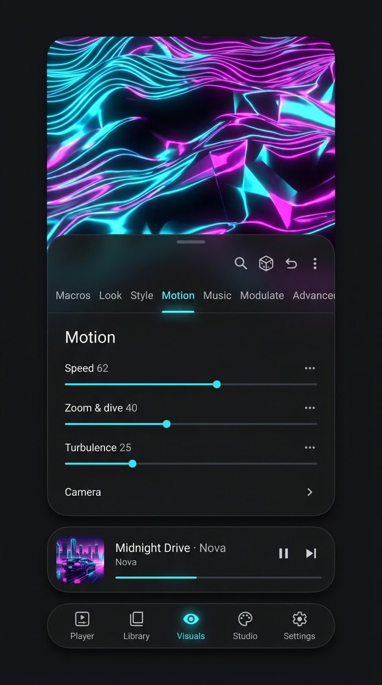

# UI redesign (draft spec, 2026-11-02)

The owner's decisions from the UI and app-flow grilling. This is still in progress: nothing is built yet, and the open questions are at the end.

**How to work on this:** use the Android UI skills (`android-cli`, `navigation-3`, `adaptive`, `edge-to-edge`, `jetpack-compose-performance`), the official Android and Material 3 documentation (`android docs`, developer.android.com, m3.material.io), and a UI design expert review (design skills or agents) for every screen. Follow standard Android patterns before anything custom.

*Mockup made with Google Flow. In the real design, the visual fills the whole screen behind the floating sheet.*

## Look
- One dark theme of floating black matte glass, translucent, with soft real shadows. It should feel classy, expensive, familiar and high tech.
- The sheet, mini player, quick settings and pop-ups sit 8–12 dp in from the screen edges with ~28 dp corners. The tab bar is a floating pill.
- No glows, glowing hairlines or shard corners.
- Material Symbols Rounded icons; standard M3 type scale, compact.
- The accent colour follows the current visual and falls back to #9CC7FF.
- M3 Expressive motion with haptics, following the system reduce-motion setting.

## Visuals
- The visual always fills the screen. Options sit in a floating sheet that snaps to peek, half or tall. The user sets the sheet's opacity.
- The four tabs stay: Styles, Customize, Presets, MilkDrop.
- Styles are grouped by what you see (about 10 groups), shown as real thumbnails, with a crown on Pro styles.
- **Gestures on the visual.** A swipe only counts when it starts away from the system edges.
  - Tap the bottom: mini player and icons. Tap the top: quick settings.
  - Double tap: toggle the sheet.
  - Swipe sideways: next style, preset or playlist entry (the user picks which).
  - Swipe up: mini player. Swipe down: the Macros drawer.
  - Long press: record (a ring fills for ~0.8 s first).
  - Two circles: randomize. Two-finger drag: touch the visual.
- **Icons on the visual:** Record at bottom right; Studio and Fullscreen at top right; ‹ › at the side edges.
- **Mini player:** art, title and artist, play/pause, next, and a progress line. It fades on every screen after a time the user sets.
  - Tap it to keep it shown. Swipe it up to open Player. Swipe it down to hide it.
  - Once it has faded, a handle pill brings it back.
- Back retraces the user's route.

## Customize
- The pages are stacked in one vertical scroll, with a sticky header that jumps to each page: Macros · Look · Style · Motion · Music · Modulate♛ · Advanced♛.
- 🔍 🎲 ↶ ⋯ sit in the sticky header. There is one "Randomize" everywhere.
- Deeper parts drill in within the same sheet, with ← and a title: the Macro editor, Sets & macros, Make a palette, the Route editor. Advanced's groups step with ‹ › "2 of 3".
- **Rows:** two-line sliders (~64 dp) with a trailing ⋮ menu (what is this, keep when randomizing, make it react ♛, reset). No lock icon on each row; no hint paragraphs.
- **Pro:** a ♛ on the page or section header. The user can try a Pro control; the paywall opens when they want to keep it.
- **Music page:** moments → actions (Kick, Snare, Drop, Chord change, Notes…), with one Strength. Auto means the director chooses; a moment set by hand stays the user's.

## Studio
- Tabs: Render · My videos · Edit♛. Studio opens on the last tab used, never on a Pro wall.
- Render starts with a choice: "Render a new video" or "Use an existing video" (a take, a past render or a phone video). It then shows only the steps that choice needs.
- The first recording asks where to save. After that, the user can make that folder the default.

## First run, tour, Settings
- First run is the safety notice only. Music access is asked the first time Library opens.
- **Tour:** pointers and transparent glass pop-ups on the real controls, in the standard Android way. One short guided path, then pointers on each screen's first visit. There is no card carousel.
- **Settings:** a standard Android list with 7 groups: Playback & audio, Library & folders, Display & performance, Export & save, Wallpaper & screensaver, Tutorials & help, Backup & about. Pro options are shown bold with ♛. Lyrics goes.

## Still open
- Contents of the Visuals quick settings.
- Styles details (the Featured row, search, preview).
- The Player and Library screens.
- How an existing video is edited.
